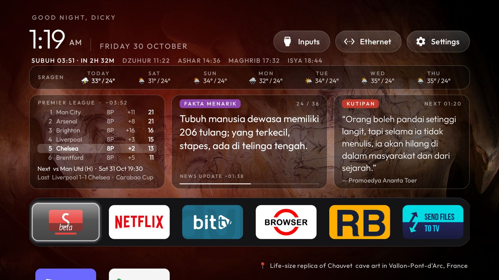
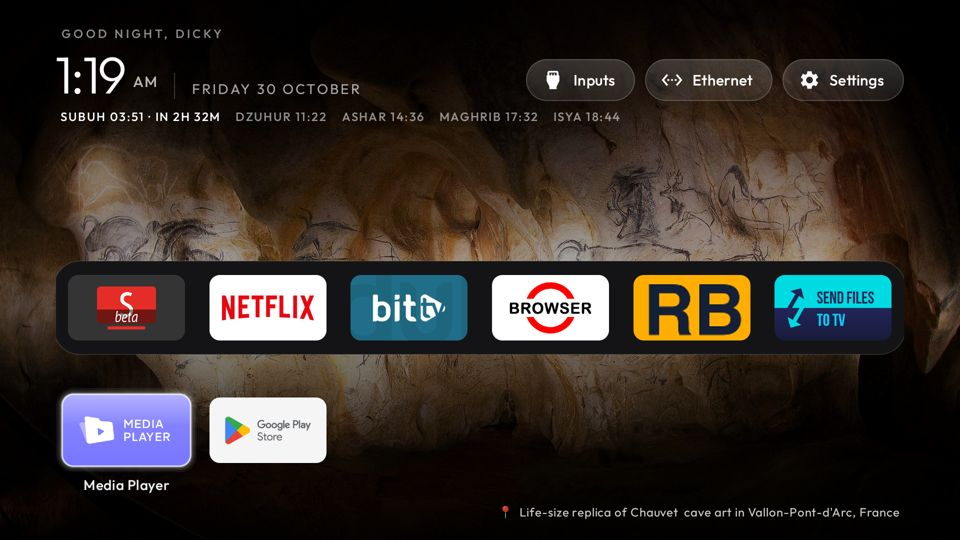
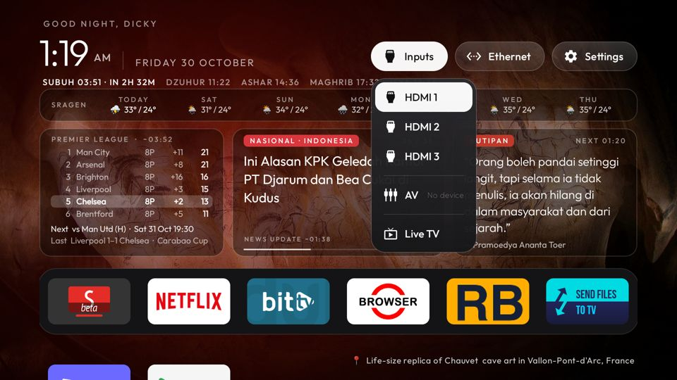
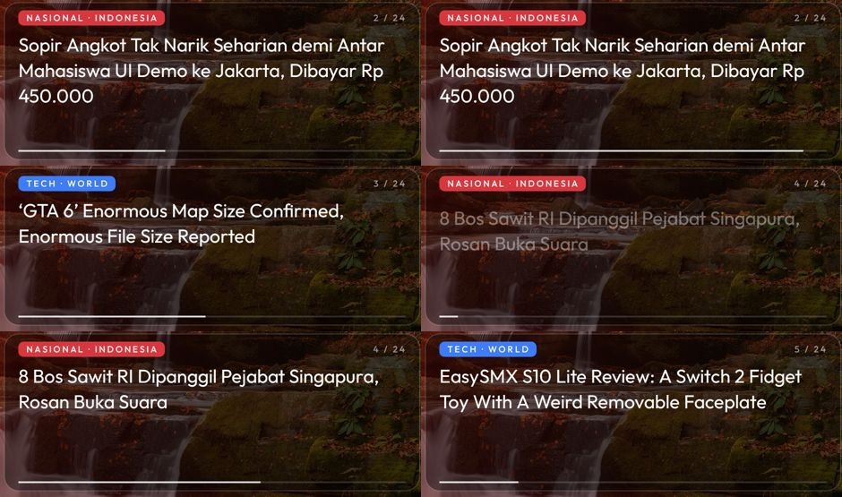
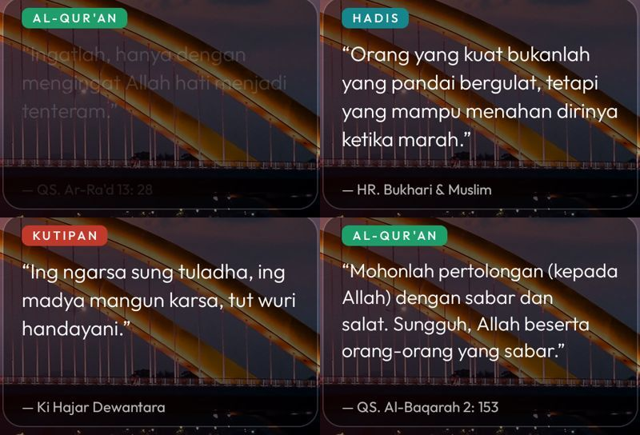

# Xiaomi TV clean launcher

A debloated Xiaomi Google TV with a custom Apple TV style home screen: a black-glass home with live info cards,
a rotating travel-photo wallpaper and a full-screen travel screensaver. It runs on a 75" Xiaomi TV A Pro 2026.



Based on [Gathin23/cleanyourtv](https://github.com/Gathin23/cleanyourtv) (MIT). This repo adds the info cards,
the travel wallpaper and screensaver, and the scripts used on this TV.

## What's on the home screen

| Part | What it shows | Source | How often it changes |
|---|---|---|---|
| Header | Greeting, clock, date | the TV | live |
| Prayer times | Subuh, Dzuhur, Ashar, Maghrib, Isya for Sragen, Central Java. The next prayer is highlighted with a countdown | **calculated on the TV** (Kemenag RI method: Fajr 20°, Isha 18°, +2 min ihtiyat), no internet | every minute |
| Weather strip | 7 days: icon, high / low °C | [Open-Meteo](https://open-meteo.com) | every 3 h |
| Premier League | Top 6 of the table, Chelsea highlighted, Chelsea's next match (local time) and last result | ESPN public API | every 3 h |
| News & facts | One item at a time with a slide-up animation and progress bar: **Tech · World** (blue), **Nasional · Indonesia** (red), **Fakta menarik** (purple) | Google News RSS + a bundled list of fun facts | a new item every 8 s, headlines refreshed hourly |
| Quote | Al-Qur'an (Kemenag translation), Hadis, Indonesian and English quotes, with their source | bundled list, no internet | every 10 min, fades between quotes |
| Wallpaper | Travel/nature photo with a "📍 Place, Country" caption | Bing photo of the day (animals and photos without a place are skipped) | every 30 min, crossfade |
| Dock | Your favourite apps (here: SmartTube, Netflix, bitTV, Browser, RB, Send Files to TV), 6 per row | the TV | — |

Each card shows when its data is fetched next ("news update ~01:38", "next 01:20"). Nothing is fetched while
another app is open. Everything is cached on the TV, so the last data stays on screen when the internet is down.
No API keys are needed.

<p>
  
  
</p>

*Left: press Down for the full app grid (the info cards fade away). Right: the Inputs menu switches HDMI / AV / Live TV.*

<p>
  
  
</p>

*Left: news card frames, with the old headline sliding up and out and the next one coming in. Right: four quotes from the quote card.*

### Screensaver

After the TV is idle (10 min by default, set in the TV's own Settings), the screensaver shows the travel photos full
screen. The country and place appear bottom left and the clock top right. A new photo comes every 45 s with a slow
crossfade and a gentle zoom. It uses only photos the home screen already downloaded, so it needs no internet.

<p>
  
  
</p>

## The TV

| | |
|---|---|
| Model | Xiaomi TV A Pro 75" 2026, MiTV-MZTU0 (codename `river`), MediaTek |
| OS | Google TV / Android 14 (SDK 34), firmware V816.0.25.x URTMIXM |
| RAM | 1.8 GB. The launcher uses about 65–75 MB |

Other Xiaomi / Android TVs should work too. See the upstream repo for per-model notes.

## Debloat

26 packages were **disabled** for user 0 with `pm disable-user`. Nothing was uninstalled, so everything can be undone.
The list is in [`disabled.log`](disabled.log).

| Group | Disabled |
|---|---|
| Telemetry | Mi analytics, Xiaomi statistics, quality-stats uploader, Google feedback |
| Ads / content | PatchWall, Mi Home tab, Mi Channel, Mi TV+, web content, partner auto-installs |
| Background | TV Manager cleaner, firmware update services (3) |
| Unused apps | Prime Video, YouTube (SmartTube is used instead), Google TV / Play Movies, Play Games, Mi Music, Mi Gallery |
| Cast / voice | Chromecast built-in, Miracast, Mi Cast, Google Assistant |
| Home | Google TV launcher, setup wizard, Google ambient screensaver |

**Kept:** Live TV / HDMI inputs, remote and Bluetooth services, Gboard, Play Store and Play Services, game mode.

Extras:
- **Ad-blocking DNS:** Private DNS is set to `dns.adguard-dns.com`. It doesn't block YouTube ads. To undo:
  `adb shell settings put global private_dns_mode opportunistic`.
- **Storage:** the Play Store updates of the disabled apps were removed, freeing ~540 MB.

### Google TV 14 gotchas

- Home is chosen by intent priority. If you disable only the Google TV launcher, Home falls to the setup wizard's
  `RecoveryActivity`, which crash-loops the TV. You must disable `com.google.android.tungsten.setupwraith` too.
- **Disabling the setup wizard deletes the Wi-Fi network that was saved during first setup**, which takes the TV
  offline. Check first with `adb shell dumpsys wifi | grep -o 'cname=[^ ]*'`. If it shows `setupwraith`, forget that
  network in Settings and join it again before disabling.
- `adb install` can hang on Android 14. Push the APK and run `pm install -r` instead (the scripts do this).

## Setup

Needs `adb`, plus JDK 17 and the Android SDK (platform 34) to build. Turn on **USB debugging** on the TV
(Settings → System → About → press *Android TV OS build* 7 times → Developer options), then:

```bash
adb connect <tv-ip>:5555                                  # accept the prompt on the TV
TV_HOST=<tv-ip> ./disable.sh telemetry com.miui.tv.analytics com.xiaomi.statistic   # one batch at a time, screenshots in shots/
TV_HOST=<tv-ip> ./build-and-install.sh                    # build + install the launcher, make it Home
adb shell pm disable-user --user 0 com.google.android.tungsten.setupwraith   # read the Wi-Fi gotcha first
adb shell pm disable-user --user 0 com.google.android.apps.tv.launcherx
adb shell settings put secure screensaver_components com.gathin.tvhome/.ClockDream
```

`keys.sh` sends remote key presses and saves a screenshot after each one, for checking layouts:
`TV_HOST=<tv-ip> ./keys.sh down:DPAD_DOWN up:DPAD_UP`.

**Afterwards, switch USB debugging off.** ADB on port 5555 is unencrypted. Revoke the authorisations, turn debugging
off and restart the TV.

## Customise

Everything is in [`launcher/app/src/main/res/values/config.xml`](launcher/app/src/main/res/values/config.xml).
Rebuild with `./build-and-install.sh` after changing it.

| Setting | Key |
|---|---|
| Dock apps and their order | `dock_apps`, `columns` |
| Greeting name | `greeting_name` |
| Prayer location / margin | `prayer_lat`, `prayer_lng`, `prayer_tz`, `prayer_ihtiyat` (empty lat = hidden) |
| Weather on/off, place name | `weather`, `weather_place` |
| Football team and league | `football_team_id` (ESPN id, 363 = Chelsea), `football_league` (`eng.1`) |
| News feeds and speed | `news_tech_url`, `news_local_url`, `news_seconds` |
| Quote interval | `quote_minutes` (0 = hidden) |
| Wallpaper rotation | `wallpaper_rotate_minutes` (0 = off) |

The quotes and facts are plain lists in
[`Quotes.java`](launcher/app/src/main/java/com/gathin/tvhome/Quotes.java) and
[`Facts.java`](launcher/app/src/main/java/com/gathin/tvhome/Facts.java), so you can add or fix entries there.
The prayer calculation has a check against the Aladhan API, which you can run with `tests/prayer-check.sh`.

## Restore to stock

```bash
TV_HOST=<tv-ip> ./restore.sh          # re-enables everything in disabled.log + setup wizard + Google TV home, resets DNS
adb uninstall com.gathin.tvhome       # optional
adb reboot
```

Run `restore.sh` **before a factory reset**, because the reset needs the setup wizard.

## Notes

- Personal project, not affiliated with Xiaomi or Google.
- Wallpaper and screensaver photos come from Bing's photo of the day and belong to their photographers (credited by
  Bing). They're shown for personal use. The screenshots here are of the TV's screen.
- News headlines come from Google News. Sports data comes from ESPN's public endpoints. Weather comes from Open-Meteo
  (CC BY 4.0).
- License: MIT (see [LICENSE](LICENSE)). The Outfit font is under the SIL Open Font License
  ([`launcher/FONT-LICENSE-OFL.txt`](launcher/FONT-LICENSE-OFL.txt)).

---

**Ringkasan (ID):** Repo ini berisi setup TV Xiaomi 75" (Google TV 14): debloat 26 aplikasi bawaan (dinonaktifkan,
bukan dihapus) dan home screen baru bergaya Apple TV. Home screen menampilkan jadwal sholat Sragen yang dihitung
langsung di TV, cuaca 7 hari, klasemen Liga Inggris dengan Chelsea disorot, berita Tech/Nasional plus fakta menarik,
quote Al-Qur'an/Hadis/Indonesia/Inggris, dan wallpaper foto wisata yang berganti berikut nama tempat dan negaranya.
Saat TV idle, screensaver menampilkan foto wisata layar penuh yang berganti halus. Untuk kembali ke kondisi
pabrik, jalankan `restore.sh`.
